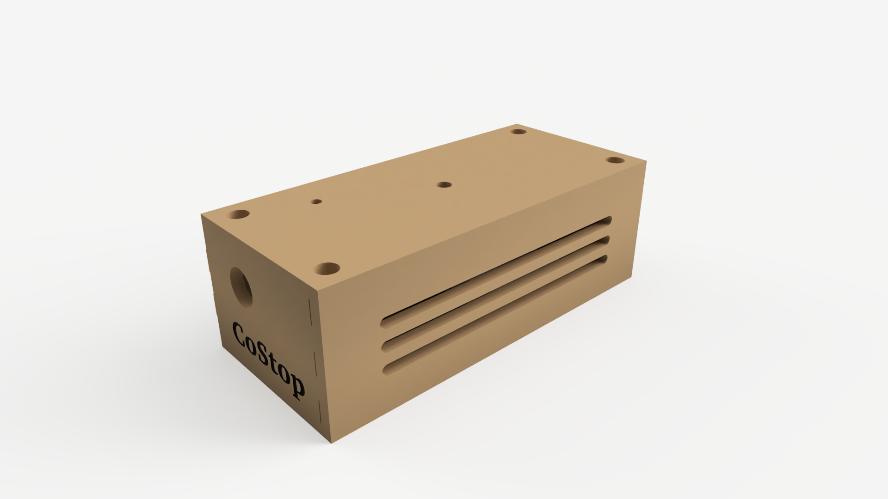

# COStop – El gas que no se ve

Proyecto final de Taller de Diseño en Ingeniería (TEI201) – Facultad de Ingeniería y Ciencias – Universidad Adolfo Ibáñez.

## Información del Equipo
**Grupo 5**
**Integrantes:**
  - Benjamin Bidegain 
  - Martin Flores 
  - Vicente Pincheira 
  - Thomas von Fabeck 

- **ODS Seleccionado:** ODS 3 – Salud y bienestar

- **Problema a resolver:** Las familias del sur de Chile que se calefaccionan con leña, parafina o kerosene no tienen dispositivos accesibles para medir el monóxido de carbono (CO), un gas incoloro e inodoro. Los ingresos a centros asistenciales por intoxicación con CO pasaron de 13 en 2023 a 31 en 2024 (solo hasta mayo), y los grupos más afectados son los adultos mayores (60%) y los preescolares (14%). En 2025 se certificaron 116.423 nuevas estufas a kerosene, así que el riesgo sigue creciendo.

## Descripción del Proyecto

**COStop** es una alarma doméstica de CO de bajo costo y fácil instalación, dirigida a adultos mayores y familias con niños pequeños en hogares del sur de Chile con calefacción a combustión. No requiere cambiar el sistema de calefacción: hace visible un riesgo que hoy es invisible, avisando con luz y sonido antes de que el CO alcance niveles peligrosos para dar tiempo a ventilar o evacuar.

El prototipo está basado en un **ESP32-S3 Super Mini**. Mide continuamente el gas con un sensor **MQ-7** y la temperatura/humedad con un **DHT11**, funciona con batería LiPo recargable y avisa con un LED RGB y un buzzer. Además, cuando el CO llega a nivel de peligro **envía una alerta por Telegram a un tercero** (familiar o vecino) y registra las lecturas en una **base de datos PostgreSQL en la nube** (API en Railway + Aiven), con respaldo local en la memoria del ESP32 si no hay WiFi:

| Estado | LED RGB | Buzzer |
|---|---|---|
| Calentamiento (warm-up) | Azul intermitente | Apagado |
| Normal | Verde fijo | Apagado |
| Alerta | Amarillo fijo | Apagado |
| Peligro | Rojo fijo | Continuo + mensaje de Telegram |

Un pulsador permite **silenciar** el buzzer por 5 minutos (no desactiva la alarma). El sistema usa histéresis para que la alarma no parpadee en el umbral.

> ⚠️ Prototipo académico: **no reemplaza un detector de CO certificado.**



## Estado del proyecto

- **Versión actual:** v3.0
- **Última actualización:** 18/11/2026
- **Estado:** Prototipo final funcional con alertas por Telegram y registro en la nube. Pendiente: calibración del MQ-7 en ppm y testing final.

## Resultados clave

| Medida | Resultado | Origen |
|---|---|---|
| Costo real del prototipo | $3.580 CLP | BOM |
| Costo estimado por unidad | ~$42.160 CLP | BOM (precios de referencia) |
| Intervalo de lectura de sensores | 2 s | Diseño del firmware |
| Intervalo de registro (flash + nube) | 10 s en pruebas, 60 s en uso real | Diseño del firmware |
| Tiempo hasta recibir el Telegram | 5 s | Prueba técnica |
| Tiempo de respuesta medido | 5 s | Prueba técnica |
| Testing con usuarios | - | — |

## Estructura del Repositorio
```
├── FUENTES.md         # Fuentes, librerías y modelos de terceros
├── hardware/          # Selección de componentes, esquemas, BOM y fotos
├── software/          # Firmware ESP32, servidor/base de datos, librerías y docs
├── diseno_3d/         # Modelo Fusion 360, planos y renders
├── testing/           # Protocolo de pruebas
├── documentacion/     # Reporte final y presentación
└── iteraciones/       # Historial v1 → v2 → v3
```

## Dónde está cada criterio de la rúbrica

| Dimensión | Criterio | Dónde mirarlo |
|---|---|---|
| Software | Código y calidad | [software/src/costop](software/src/costop) y [software/README.md](software/README.md) |
| | Captura y repositorio de datos | [software/servidor](software/servidor) (API + PostgreSQL) |
| | Alertas / generación de información | Telegram, ver [software/README.md](software/README.md) |
| | Documentación y diagramas | [software/docs](software/docs) |
| | Librerías | [software/librerias](software/librerias) y [FUENTES.md](FUENTES.md) |
| Hardware | Selección de componentes | [hardware/README.md](hardware/README.md) |
| | Esquemático y BOM | [hardware/esquemas](hardware/esquemas) y [hardware/bom](hardware/bom) |
| | Montaje físico | [hardware/fotos](hardware/fotos) |
| | Diseño para la reparación | [hardware/README.md](hardware/README.md#diseño-para-la-reparación) |
| Diseño 3D | Modelo Fusion 360 | [diseno_3d/fusion360](diseno_3d/fusion360) |
| | Funcionalidad del encapsulado | [diseno_3d/JUSTIFICACION_DISENO.md](diseno_3d/JUSTIFICACION_DISENO.md) |
| | Planos técnicos | [diseno_3d/planos](diseno_3d/planos) |
| | Renders | [diseno_3d/renders](diseno_3d/renders) |
| Testing | Protocolo de pruebas | [testing/reportes/protocolo_pruebas.md](testing/reportes/protocolo_pruebas.md) |
| Iteraciones | Evolución v1–v3 | [iteraciones](iteraciones) |
| Presentación | Slides | [documentacion/presentacion](documentacion/presentacion) |

## Inicio Rápido

### Requisitos Previos

- Arduino IDE 2.x
- Red WiFi de 2,4 GHz y un bot de Telegram (creado con @BotFather)
- Cuentas gratuitas en Railway y Aiven (solo para la base de datos)
- Soporte de placas ESP32 (Espressif) instalado en el gestor de placas
- Librería *DHT sensor library* (Adafruit) y *Adafruit Unified Sensor*
- Fusion 360 (para abrir el modelo 3D)

### Instalación

1. Clonar el repositorio.
2. Instalar las librerías (ver [software/librerias/README.md](software/librerias/README.md)).
3. En `software/src/costop/` copiar `secrets_example.h` como `secrets.h` y completar WiFi, Telegram y servidor.
4. Abrir `software/src/costop/costop.ino` en Arduino IDE y seleccionar la placa **ESP32S3 Dev Module**.
5. Conectar el hardware según [hardware/README.md](hardware/README.md#conexiones).
6. Cargar el código y abrir el Monitor Serie a 115200 baudios.
7. (Opcional) Desplegar la base de datos siguiendo [software/servidor/README.md](software/servidor/README.md).

## Checklist de Entrega

### Hardware
- [ ] Esquema del circuito (Fritzing/Wokwi)
- [x] BOM completo
- [ ] Fotos de alta resolución

### Software
- [x] Código comentado
- [x] Librerías documentadas
- [x] Manual de instalación
- [x] FUENTES.md
- [x] Base de datos en la nube (API + PostgreSQL)
- [x] Alertas por Telegram

### Diseño 3D
- [x] Archivo Fusion 360 (.f3d)
- [x] Renders (3 ángulos)
- [x] Planos técnicos

### Testing
- [x] Protocolo de pruebas
- [ ] Testing con usuarios (no realizado)

### Documentación
- [ ] Reporte final (máx. 15 páginas)
- [x] Presentación (10 min)
- [x] Avance 1 (`COStop_Avance1.pdf`)

## Fuentes

Ver [FUENTES.md](FUENTES.md).

---

## Licencia

Este proyecto es desarrollado como parte del curso TEI201 - Facultad de Ingeniería y Ciencias - Universidad Adolfo Ibáñez. Ver (LICENSE).
