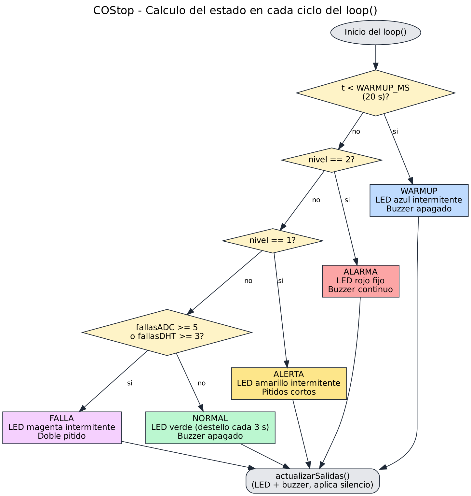
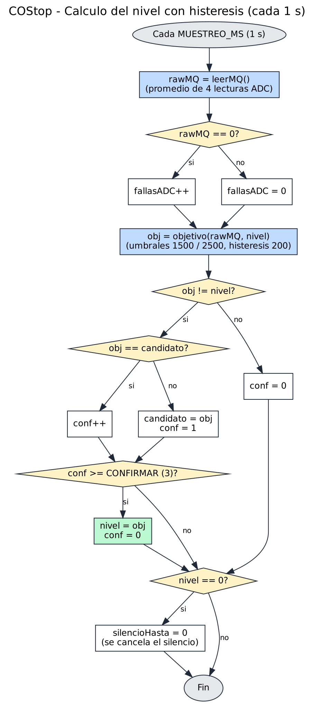

# Documentación de Software

## Diagramas





## Flujo del `loop()` (v3)

```
loop()
├─ revisarWiFi()              reconecta si se cayó (cada 15 s)
├─ actualizarCalentamiento()  LED azul hasta TIEMPO_CALENTAMIENTO
├─ revisarBoton()             silencio del buzzer
├─ cada 2 s:  leer MQ-7 y DHT11 → evaluarAlarma()
├─ cada 10 s: guardarFlash() + enviarNube(co, temperatura, humedad)
└─ comandos Serial: d / i / b
```

## Lógica de nivel con histéresis

| Lectura MQ-7 | Nivel anterior | Nivel nuevo |
|---|---|---|
| ≥ 3000 | cualquiera | 2 (peligro) |
| 2850 – 2999 | 2 | 2 |
| 2000 – 2999 | 0 o 1 (o 2 bajo 2850) | 1 (alerta) |
| 1850 – 1999 | 2 | 1 |
| 1850 – 1999 | 0 o 1 | se mantiene |
| < 1850 | cualquiera | 0 (normal) |

## Funciones principales

**`void evaluarAlarma()`**
- Calcula el nivel según la tabla anterior.
- Nivel 2: LED rojo, buzzer (salvo silenciado) y un único Telegram por evento (`alertaEnviada`).
- Nivel 1: LED amarillo, buzzer apagado.
- Nivel 0: LED verde; si venía de peligro envía "niveles normales otra vez".

**`void enviarNube(const char* sensor, float valor)`**
- Envía `{"dispositivo":"costop-1","sensor":"co","valor":812.00}` a `SERVER_URL` con header `x-api-key`.
- Si no hay WiFi o el valor es `NaN`, no envía (el dato queda en flash).

**`void enviarTelegram(const String& msg)`**
- POST a `https://api.telegram.org/bot<TOKEN>/sendMessage` con `chat_id` y `text`.

**`void revisarBoton()`**
- Botón en `INPUT_PULLUP` (presionado = LOW), antirrebote de 50 ms.
- Solo actúa en peligro: apaga el buzzer durante `SILENCIO_MS`.

## API del servidor

Ver [`../servidor/README.md`](../servidor/README.md).

## Manual de usuario (resumen)

1. Cargar el equipo por micro-USB y encenderlo con el interruptor.
2. Esperar que el LED pase de azul a verde.
3. **Amarillo:** abrir ventanas y revisar estufas.
4. **Rojo + sonido:** apagar la estufa, ventilar y salir del lugar. El contacto registrado recibe un Telegram.
5. El botón silencia el sonido 5 minutos, pero la alarma sigue activa.

## Troubleshooting

| Problema | Causa probable | Solución |
|---|---|---|
| `[aviso] sin WiFi` | Red de 5 GHz, clave mala o señal débil | Usar red 2,4 GHz; revisar `secrets.h`; ver lista `[scan]` |
| `[telegram] codigo 401` | Token inválido o revocado | Generar token nuevo con @BotFather |
| `[telegram] codigo 400` | `chat_id` incorrecto o el usuario no le escribió al bot | Enviar `/start` al bot y revisar el chat_id |
| `[nube] co -> 401` | API key distinta a la de Railway | Igualar `API_KEY` en `secrets.h` y Railway |
| `[nube] co -> -1` | URL mala o servidor caído | Revisar `SERVER_URL` y `/salud` del servidor |
| `[ERROR] LittleFS no monto` | Partición sin formatear | Se formatea sola (`begin(true)`); si persiste, cambiar esquema de partición |
| Siempre alerta/peligro | MQ-7 sin calentar o sin calibrar | Esperar calentamiento; recalibrar umbrales |
| No compila: `secrets.h` no encontrado | Falta crear el archivo | Copiar `secrets_example.h` como `secrets.h` |
