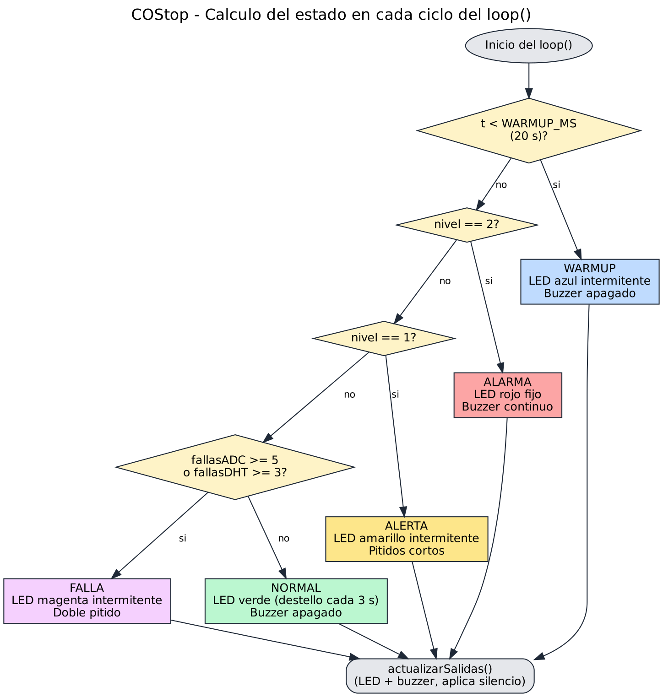
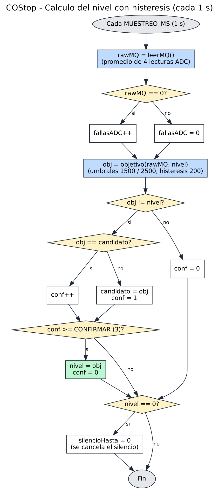

# Documentación de Software 

## Contenido

### Diagramas de Flujo

**Cálculo del estado en cada ciclo del `loop()`**




**Cálculo del nivel con histéresis (cada 1 s)**




### Documentación de Funciones

**setColor(bool r, bool g, bool b)**
- **Propósito:** enciende el LED RGB. Si `LED_ANODO_COMUN` es true, invierte los niveles.
- **Parámetros:** `r`, `g`, `b` (1 = componente encendido).
- **Retorna:** nada.
- **Ejemplo:**
```cpp
setColor(1, 1, 0);  // amarillo
```

**buzzerOn() / buzzerOff()**
- **Propósito:** enciende o apaga el buzzer. Con buzzer activo usa `digitalWrite`; con pasivo usa `tone(…, 2000)` / `noTone`.
- **Parámetros:** ninguno. **Retorna:** nada.

**int leerMQ()**
- **Propósito:** reduce el ruido promediando 4 lecturas ADC del sensor MQ.
- **Parámetros:** ninguno.
- **Retorna:** `int` entre 0 y 4095.
- **Ejemplo:**
```cpp
rawMQ = leerMQ();
```

**int objetivo(int raw, int actual)**
- **Propósito:** determina el nivel que corresponde a una lectura, con histéresis para no oscilar.
- **Parámetros:** `raw` (lectura ADC), `actual` (nivel vigente).
- **Retorna:** `0` normal, `1` alerta, `2` alarma.
- **Ejemplo:**
```cpp
int obj = objetivo(rawMQ, nivel);
```

**revisarBoton()**
- **Propósito:** lee el botón con antirrebote de 50 ms; al presionarlo en ALERTA, ALARMA o FALLA activa el silencio del buzzer durante `SILENCIO_MS`.
- **Parámetros:** ninguno. **Retorna:** nada.

**actualizarSalidas()**
- **Propósito:** define el patrón de LED y buzzer según el estado y aplica el silencio.
- **Parámetros:** ninguno (usa la variable global `estado`). **Retorna:** nada.

**Patrones por estado**

| Estado | Patrón LED | Patrón buzzer |
| WARMUP | azul, 200 ms encendido cada 400 ms | apagado |
| NORMAL | verde, 80 ms cada 3 s | apagado |
| ALERTA | amarillo, 200 ms cada 1 s | 200 ms cada 1 s |
| ALARMA | rojo fijo | continuo |
| FALLA | magenta, dos destellos de 150 ms cada 2 s | doble pitido sincronizado |


## Manual de Instalación

1. Instalar Arduino IDE 2.x desde https://www.arduino.cc/en/software.
2. En `Archivo > Preferencias`, agregar en *Gestor de URLs adicionales de tarjetas*:
   `https://raw.githubusercontent.com/espressif/arduino-esp32/gh-pages/package_esp32_index.json`
3. En `Herramientas > Placa > Gestor de tarjetas`, instalar **esp32** (Espressif Systems).
4. En `Herramientas > Administrar bibliotecas`, instalar **DHT sensor library** y **Adafruit Unified Sensor**.
5. Abrir `software/src/codigo_esp32/codigo_esp32.ino`.
6. Seleccionar la placa **ESP32S3 Dev Module** y el puerto COM.
7. Compilar y subir.
8. Abrir el Monitor Serie a **115200 baudios**.

Conexiones (pines): DHT11 → 4, MQ → 1, buzzer → 5, LED RGB → R 6 / G 8 / B 9, botón → 0 (BOOT, provisorio).


## Manual de Operación

### Encendido del Sistema
1. Alimentar el dispositivo por USB o fuente.
2. El LED parpadea en **azul** durante el calentamiento (20 s en el prototipo; minutos en equipo real).

### Operación Normal
1. **Verde** con destello breve cada 3 s: ambiente normal, sin sonido (el destello indica que el equipo está funcionando).
2. **Amarillo intermitente + pitidos cortos:** alerta. Ventilar el lugar.
3. **Rojo fijo + sonido continuo:** alarma. Ventilar y evacuar.
4. **Magenta intermitente + doble pitido:** falla de sensor. Ver Troubleshooting.
5. El botón silencia el buzzer 30 s (5 min en equipo real); el LED sigue activo y el silencio se cancela cuando el nivel vuelve a normal.

### Apagado del Sistema
1. Desconectar la alimentación. Al reencender se repite el calentamiento.


## Troubleshooting

### Problemas Comunes

**Problema 1: Error "DHT.h: No such file or directory"**
- Causa probable: no está instalada la librería DHT.
- Solución: instalar DHT sensor library y Adafruit Unified Sensor.

**Problema 2: LED magenta con doble pitido (falla)**
- Causa probable: el MQ entrega 0 de forma sostenida (5 lecturas) o el DHT11 falla 3 lecturas seguidas (cableado suelto o pin incorrecto).
- Solución: revisar el cableado, ver `DHT_fallas` y `MQ=` en el Monitor Serie y reiniciar.

**Problema 3: Falsas alarmas al encender**
- Causa probable: el MQ aún no se estabiliza.
- Solución: dejar completar el calentamiento y, si persiste, recalibrar `T_ALERTA` y `T_ALARMA`.

**Problema 4: No aparece el puerto COM**
- Causa probable: cable solo de carga o falta de driver.
- Solución: usar un cable de datos; mantener presionado BOOT al conectar el USB.

**Problema 5: El LED no muestra el color esperado**
- Causa probable: LED de ánodo común.
- Solución: cambiar `LED_ANODO_COMUN` a `true`.

**Problema 6: El buzzer no suena o suena distinto**
- Causa probable: tipo de buzzer mal configurado.
- Solución: `BUZZER_ACTIVO = true` para activo, `false` para pasivo.

> COStop no usa WiFi ni Bluetooth, por lo que no hay problemas de conexión de red.
